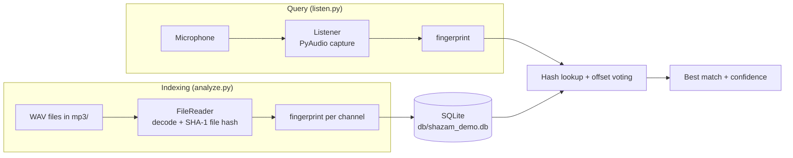

# Audio Search Engine

Audio Search Engine identifies a song from a few seconds of microphone audio. It is a Python implementation of the landmark-based fingerprinting method that Shazam uses (Wang, 2003).

To build the index, the program converts each reference track into a spectrogram, pairs its strongest peaks into short hashes, and stores them in a SQLite database. To identify a song, it records a clip from the microphone, fingerprints it the same way, and reports the indexed track that shares the most hashes with the recording. Signal processing uses NumPy, SciPy and Matplotlib; pydub reads the audio files and PyAudio handles microphone capture.

Developed as a bachelor project, 2021-2022.

## Contents

- [Motivation](#motivation)
- [Method](#method)
- [System design](#system-design)
- [Installation](#installation)
- [Usage](#usage)
- [Configuration](#configuration)
- [Limitations](#limitations)
- [Acknowledgements](#acknowledgements)
- [References](#references)

## Motivation

Identifying a song from a few seconds of noisy microphone audio is hard to do by comparing waveforms directly. Room acoustics, background noise, and microphone quality all change the raw signal. Wang (2003) showed that the positions of the strongest peaks in a spectrogram survive most of this distortion, and that pairs of peaks can be hashed into compact fingerprints suited to fast database lookup. This project implements that approach end to end at a small scale, as a way to study each stage of the pipeline.

## Method

Indexing and querying use the same fingerprinting procedure, implemented in [src/analyzer.py](src/analyzer.py).

1. Spectrogram. Each audio channel is split into frames of 4,096 samples with 50% overlap and a Hann window, and transformed with an FFT. Magnitudes are converted to a logarithmic (decibel) scale.
2. Peak extraction. A local maximum filter finds time-frequency points that are louder than every neighbour within a fixed region (a diamond-shaped neighbourhood grown over 20 iterations). Peaks below an amplitude threshold of 20 dB are discarded, which leaves a sparse "constellation map" of the track.
3. Combinatorial hashing. Peaks are sorted by time. Each peak acts as an anchor and is paired with the 14 peaks that follow it, provided the time gap is between 0 and 200 frames. Each pair is encoded as the string `f1|f2|Δt`, hashed with SHA-1, and truncated to 20 hexadecimal characters. The fingerprint is stored together with the anchor's time offset.
4. Matching. Fingerprints from the recorded clip are looked up in the database in batches of 1,000. Every hit votes for a `(song, offset)` pair, and the song with the most votes at a single offset is reported as the match. The vote count is reported as the confidence.

Because a fingerprint encodes two frequencies and the time between them, it does not depend on where the clip starts within the song. This is what lets a ten-second recording match a full-length track.

## System design



### Repository layout

| Path | Purpose |
| --- | --- |
| [analyze.py](analyze.py) | Fingerprints every `.wav` file in `mp3/` and stores the hashes |
| [listen.py](listen.py) | Records from the microphone and identifies the track |
| [reset.py](reset.py) | Drops and recreates the database tables |
| [src/analyzer.py](src/analyzer.py) | Spectrogram, peak detection, and hash generation |
| [src/filereader.py](src/filereader.py) | Decodes audio files with pydub and computes a SHA-1 hash of each file |
| [src/listener.py](src/listener.py) | Microphone capture through PyAudio |
| [src/db.py](src/db.py) | SQLite access layer |
| `mp3/` | Reference tracks to index (three sample WAV files are included) |
| `db/` | SQLite database file |

### Database schema

```sql
CREATE TABLE songs (
  id        INTEGER PRIMARY KEY AUTOINCREMENT,
  name      TEXT,
  filehash  TEXT          -- SHA-1 of the file, used to skip duplicates
);

CREATE TABLE fingerprints (
  id        INTEGER PRIMARY KEY AUTOINCREMENT,
  song_fk   INTEGER,      -- references songs.id
  hash      TEXT,         -- 20-character truncated SHA-1
  offset    INTEGER       -- anchor peak position, in spectrogram frames
);
```

## Installation

The project was developed with Python 3.10. Python 3.13 removed the standard-library `audioop` module that pydub relies on, so use Python 3.10 to 3.12.

```bash
git clone https://github.com/prathapselvakumar/Audio-Search-Engine.git
cd Audio-Search-Engine

python -m venv .venv
# Windows
.venv\Scripts\activate
# macOS / Linux
source .venv/bin/activate

pip install -r requirement.txt
```

PyAudio needs the PortAudio library. Windows wheels include it. On macOS run `brew install portaudio`, and on Debian or Ubuntu run `sudo apt install portaudio19-dev` before installing the Python packages. pydub uses FFmpeg for formats other than WAV. It is not needed for the included samples.

## Usage

### 1. Create the database tables

This deletes any existing fingerprints.

```bash
python reset.py
```

### 2. Index the reference tracks

Put `.wav` files in `mp3/`, then run:

```bash
python analyze.py
```

The script skips files whose content hash is already in the database, so it can be rerun safely after adding new tracks.

### 3. Identify a track

Play one of the indexed tracks near the microphone and run:

```bash
python listen.py --seconds 10
```

If `--seconds` is omitted, the recording length defaults to 10 seconds. Example output:

```text
Listening....
Okey, enough
Took 438272 samples
I found 1186 hash in db
Totally found 1186 hash
 => song: 1.wav (id=1)
    offset: 412 (19 secs)
```

The sample counts and offsets above are illustrative and will differ between runs.

## Configuration

The fingerprinting parameters are module-level constants in [src/analyzer.py](src/analyzer.py). Changing any of them makes existing fingerprints incompatible, so run `reset.py` and `analyze.py` again afterwards.

| Constant | Default | Effect |
| --- | --- | --- |
| `DEFAULT_WINDOW_SIZE` | 4096 | FFT frame length in samples |
| `DEFAULT_OVERLAP_RATIO` | 0.5 | Overlap between consecutive frames |
| `DEFAULT_FAN_VALUE` | 15 | Pairs per anchor peak (`fan_value - 1` neighbours are used) |
| `DEFAULT_AMP_MIN` | 20 | Minimum peak amplitude in dB |
| `PEAK_NEIGHBORHOOD_SIZE` | 20 | Size of the local-maximum region |
| `MIN_HASH_TIME_DELTA` / `MAX_HASH_TIME_DELTA` | 0 / 200 | Allowed time gap between paired peaks, in frames |
| `FINGERPRINT_REDUCTION` | 20 | Hex characters kept from each SHA-1 digest |

Higher fan values and lower amplitude thresholds produce more hashes per track. That improves recall on noisy recordings at the cost of database size and lookup time.

## Limitations

- Offset alignment: Wang's method votes on the difference between a hash's offset in the database and its offset in the query. [listen.py](listen.py) votes on the query offset alone, so the reported `offset` is not the playback position within the song. Matching still works when one track clearly dominates the hits, but it is less robust when several tracks share hashes. Using `db_offset - query_offset` as the vote key would restore the original scheme.
- Scale: Fingerprints are queried with `IN (...)` against a table that has no index on `hash`. This is adequate for a small library but would need an index, or a dedicated key-value store, for thousands of tracks.
- No evaluation: The system has been tested by hand with the three sample tracks. Recognition accuracy has not been measured against noise level, clip length, or library size.
- Input format: `analyze.py` only reads `.wav` files, although `FileReader` can decode any format that pydub and FFmpeg support.
- Deprecated NumPy call: Audio buffers are converted with `numpy.fromstring`, which is deprecated. `numpy.frombuffer` is the drop-in replacement.

## Acknowledgements

The project structure and much of the code are adapted from [audio-fingerprint-identifying-python](https://github.com/itspoma/audio-fingerprint-identifying-python) by itspoma. Its fingerprinting parameters and algorithm come from [Dejavu](https://github.com/worldveil/dejavu) by Will Drevo. Both projects are released under the MIT License.

## References

Drevo, W. (2013). *Dejavu: Audio fingerprinting and recognition in Python* [Computer software]. GitHub. https://github.com/worldveil/dejavu

Wang, A. (2003). An industrial-strength audio search algorithm. In *Proceedings of the 4th International Conference on Music Information Retrieval (ISMIR 2003)*. https://doi.org/10.5281/zenodo.1416340
# Audio-Search-Engine

